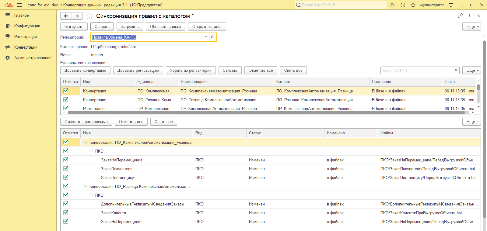
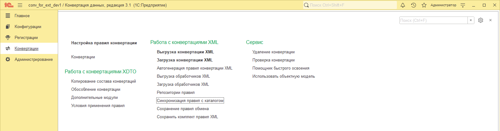
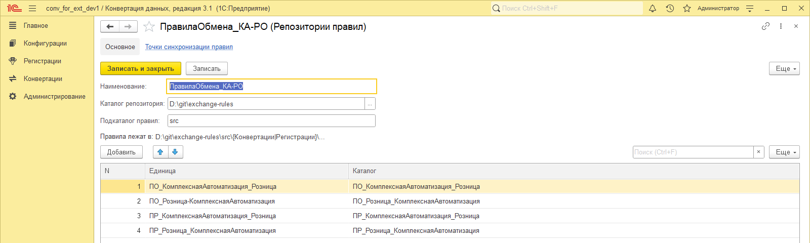
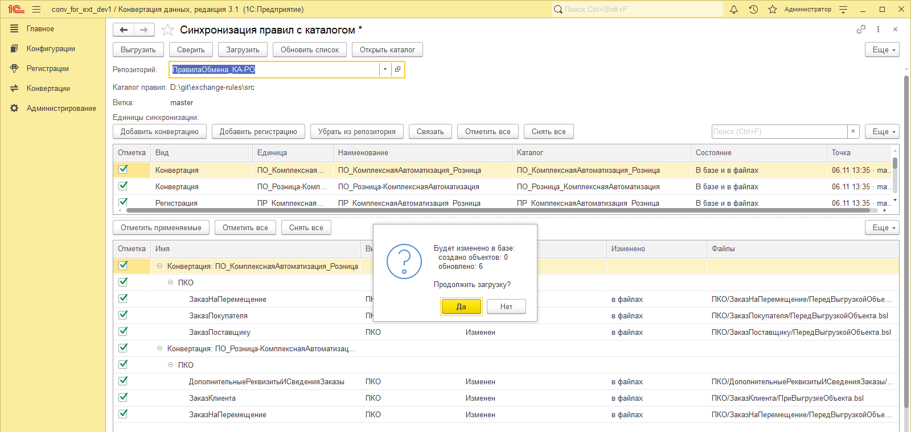
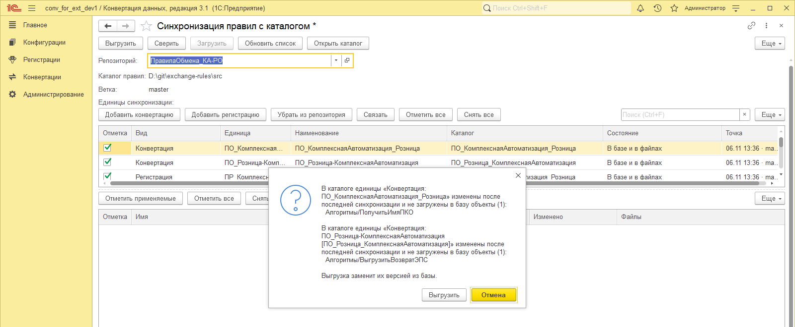
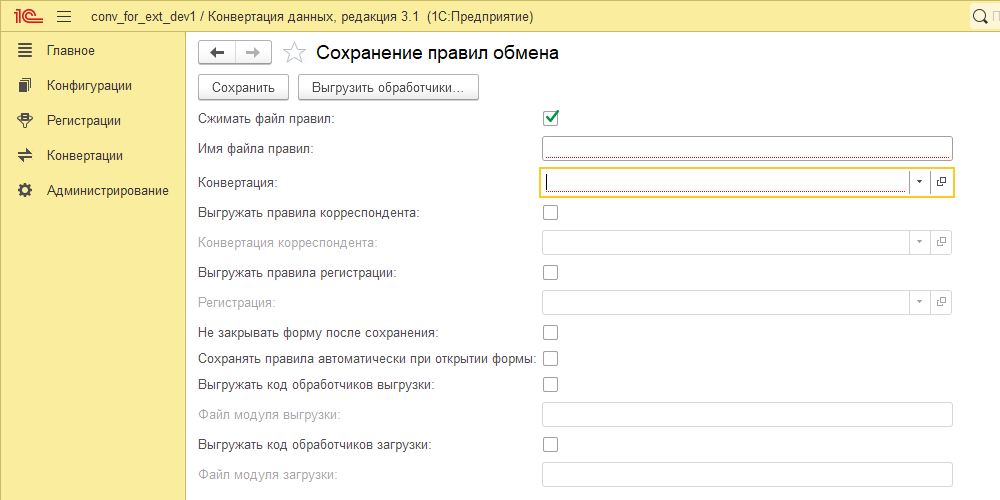
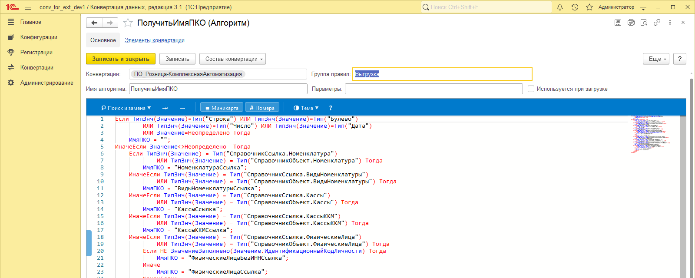
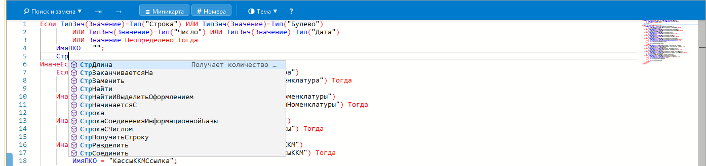
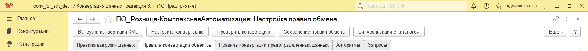

# Инструменты разработчика правил конвертации

Расширение для «1С:Конвертация данных 3.1», которое упрощает разработку правил
обмена формата XML:

- **Синхронизация правил с каталогом файлов.** Правила хранятся в git как дерево
  читаемых файлов, а не как один XML. В базу загружаются только изменённые объекты.
- **Сохранение правил обмена** одной формой, как в «Конвертации данных 2.x»: правила,
  правила корреспондента и правила регистрации, при желании одним zip-архивом.
- **Редактор кода Monaco** в формах правил и алгоритмов: подсветка синтаксиса,
  автодополнение, поиск с заменой, миникарта.
- **Навигация между формами правил** — переход из конвертации в её настройку
  и оттуда в сохранение и синхронизацию.



## Требования

- 1С:Предприятие 8.3.24 или новее. Проверено на 8.3.25.1633.
- «Конвертация данных», редакция 3.1. Проверено на 3.1.6.16.
- Тонкий клиент Windows — для редактора Monaco. В веб-клиенте формы работают
  со штатными полями ввода.
- Для синхронизации с каталогом — Windows с включёнными длинными путями, см. ниже.

## Установка

1. Скачайте `dev_tools.cfe` со страницы
   [релизов](https://github.com/AnanyevAl/conv_dev_tool/releases).
2. Добавьте расширение в базу «Конвертации данных» одним из способов:
   - в Конфигураторе: «Конфигурация» → «Расширения конфигурации» → «Добавить
     из файла»;
   - в режиме 1С:Предприятие: «Все функции» → «Стандартные» → «Управление
     расширениями конфигурации» → «Добавить».
3. Снимите у расширения флажки «Безопасный режим» и «Защита от опасных действий» —
   расширение проверялось в этом режиме: оно читает и пишет файлы каталога правил
   и запускает фоновые задания.
4. Перезапустите сеанс.

Команды расширения появятся в разделе «Конвертации»:



## Синхронизация правил с каталогом

Форма «Синхронизация правил с каталогом» выгружает XML-конвертации и правила
регистрации в каталог файлов и загружает обратно только изменённые объекты. Каталог
рассчитан на git: коммиты, ветки, pull и push делаются внешним клиентом, форма
следит за тем, где изменился каждый объект — в базе или в файлах.

### Порядок работы

1. Завести элемент справочника «Репозитории правил» (раздел «Конвертации»): каталог
   рабочей копии git и подкаталог правил внутри неё, например `src`.
2. Открыть форму синхронизации и выбрать репозиторий. В таблице единиц появятся
   найденные в каталоге конвертации и регистрации и те, что закреплены
   за репозиторием. Единицу, которой в каталоге ещё нет, добавляют кнопками
   «Добавить конвертацию» и «Добавить регистрацию».
3. Отметить нужные единицы и выполнить «Выгрузить», «Сверить» или «Загрузить».



Единиц в репозитории может быть сколько угодно: у обмена с двумя направлениями это,
как правило, две конвертации и две регистрации. Команды работают только по отмеченным
единицам, поэтому разработчик, которому нужно одно направление, снимает отметки
с остального.

### Раскладка каталога

- Один объект правил — один каталог: `Конвертации/<имя>/ПКО/<код>/ПКО.json`,
  обработчики — отдельными `.bsl` рядом, ПКС — в подкаталоге `ПКС/`, текст запроса —
  `Запрос.sdbl`; регистрация — `Регистрации/<имя>/ПРО/…`.
- В файлах нет GUID-ов: объекты и свойства метаданных записаны полными именами,
  релизы — именем конфигурации и версией. Каталог переносим между базами
  с одинаково загруженными структурами конфигураций.
- Файлы в UTF-8 без BOM с LF; повторная выгрузка без изменений не трогает ни одного
  файла. В репозиторий правил стоит положить `.gitattributes` с `* text eol=lf`.

### Сверка и загрузка

«Сверить» показывает дерево по раскладке каталога: единица, коллекции (`ПКО`,
`Алгоритмы`, `ПРО`), объекты и вложенные правила. У каждого объекта — статус
(«Новый», «Изменен», «Нет в файлах») и колонка «Изменено»: «в файлах» (пришло из git),
«в базе» (загрузка откатит правку), «с обеих сторон» или «неизвестно».

Отметки расставляются сразу после сверки: новое и изменённое отмечено, «Нет в файлах» —
нет, потому что его загрузка помечает правило на удаление. Отметка на узле
распространяется на потомков; отметка одного ПКС не исключает весь ПКО.

«Загрузить» применяет отмеченное одной транзакцией на единицу. Перед записью форма
показывает, сколько объектов будет создано, обновлено и помечено на удаление:



Загрузка отказывается, если файлы изменились после сверки, и останавливается целиком,
если в файлах есть ссылка на объект метаданных, которого нет в структуре конфигурации.

### Выгрузка

«Выгрузить» приводит каталог единицы к состоянию базы: всё, чего нет в базе,
из каталога удаляется. Если в каталоге есть изменения из git, ещё не загруженные
в базу, форма спрашивает, прежде чем их затереть:



### Фоновые операции

Серверная часть «Сверить», «Загрузить» и «Выгрузить» выполняется фоновым заданием:
форма показывает окно ожидания с прогрессом по единицам и кнопкой «Отмена». Отмена
сверки и выгрузки ничего не меняет; отмена загрузки оставляет загруженными единицы,
обработанные до неё, — после неё нужна сверка.

### Имена единиц и каталогов

Единица запоминает свой каталог при закреплении за репозиторием, и переименование
в базе каталог не меняет. Если имена разошлись между базами (правила перенесены
из другой базы, каталог переименован в git), в таблице появятся две строки —
«Только в базе» и «Только в файлах». Выделите обе и нажмите «Связать».

Поле «Ветка» читается из `.git/HEAD`; колонка «Точка» подсвечивается, если ветка
сменилась после последней синхронизации.

### Длинные пути Windows

Пути каталога правил регулярно длиннее 260 символов, а длину пути инструмент
не проверяет. На каждой рабочей станции, где работает синхронизация, включите длинные
пути (нужны права администратора и перелогин):

```bat
reg add "HKLM\SYSTEM\CurrentControlSet\Control\FileSystem" /v LongPathsEnabled /t REG_DWORD /d 1 /f
```

Без настройки выгрузка падает посреди записи и оставляет каталог единицы недописанным —
его нужно восстановить из git (`git checkout` каталога единицы).

## Сохранение правил обмена

Форма «Сохранение правил обмена» — аналог одноимённой формы «Конвертации данных 2.x».
Она открывается из раздела «Конвертации» или кнопкой в настройке правил обмена
с уже выбранной конвертацией.



Форма умеет:

- выгружать правила обмена выбранной конвертации (формат «2.01»);
- выгружать правила обмена корреспондента;
- выгружать правила регистрации объектов;
- собирать всё перечисленное в один zip-архив с именами `ExchangeRules.xml`,
  `CorrespondentExchangeRules.xml`, `RegistrationRules.xml`;
- выгружать код обработчиков выгрузки и загрузки в файлы отладочных модулей.

Ядро выгрузки не дублируется: расширение вызывает штатные механизмы
«Конвертации данных 3.1» и добавляет оркестрацию, упаковку архива и сохранение файла.

## Редактор кода

В формах правил конвертации штатное многострочное поле заменено редактором Monaco:
подсветка синтаксиса встроенного языка, автодополнение глобального контекста 1С
и общих модулей, поиск с заменой, миникарта и номера строк.



Переменные текущего обработчика (`Отказ`, `Объект`, `ВходящиеДанные` и прочие)
редактор подсказывает по фактическим сигнатурам из макетов конфигурации:



Редактор подключён к девяти формам:

| Форма | Обработчиков |
| --- | --- |
| Правила обработки данных | 4 |
| Правила конвертации объектов | 8 |
| Правила конвертации предопределённых данных | 7 |
| Правила конвертации свойств — элемент / группа | 3 / 5 |
| Правила регистрации объектов | 5 |
| Конвертации | 15 |
| Алгоритмы, Запросы | по 1 |

Ограничения:

- **Только правила формата XML.** У правил XDTO формы работают на штатных полях.
- **Только тонкий клиент Windows.** В веб-клиенте и мобильном клиенте формы
  показывают штатные поля ввода. Они же возвращаются, если редактор не запустился:
  текст не теряется.
- **Компоновка двух форм изменена**: закладки обработчиков переставлены наверх,
  а у правил регистрации страница «Пакетная обработка» перенесена в группу
  обработчиков пятой вкладкой.

## Навигация между формами правил

- В форме конвертации — кнопка «Настройка правил обмена»: открывает штатную
  настройку правил этой конвертации.
- В настройке правил обмена — кнопки «Сохранение правил обмена» и «Синхронизация
  с каталогом» (только для XML-конвертаций). Сохранение открывается с уже выбранной
  конвертацией, синхронизация — на репозитории, за которым конвертация закреплена,
  если такой репозиторий один.



## Лицензия

[MIT](LICENSE).

Редактор кода построен на [Monaco Editor](https://github.com/microsoft/monaco-editor)
и [bsl_console](https://github.com/salexdv/bsl_console) — оба под MIT, уведомления
об авторстве — в [THIRD-PARTY-NOTICES.md](THIRD-PARTY-NOTICES.md).
